<div align="center">

  <!-- ===================================================================== -->
  <!-- 1. CUSTOM ANIMATED CYBER-COSMOS HERO HUD (100% GLITCH-FREE LOCAL SVG) -->
  <!-- ===================================================================== -->
  

  <br/><br/>

  <!-- ===================================================================== -->
  <!-- 2. CENTERED SINGLE-LINE HACKER TYPEWRITER (NO LEFT-CLIPPING BUGS)     -->
  <!-- ===================================================================== -->
  <a href="https://github.com/vaibhaw1103">
    
  </a>

  <br/>

  <!-- ===================================================================== -->
  <!-- 3. INTERACTIVE NEON COMMAND UPLINK BADGES                             -->
  <!-- ===================================================================== -->
  <p align="center">
    <a href="https://www.linkedin.com/in/vaibhav-bhandari-264198248/">
      
    </a>
    <a href="mailto:vaibhav.bhandari1103@gmail.com">
      
    </a>
    <a href="https://github.com/vaibhaw1103?tab=repositories">
      
    </a>
    
  </p>

</div>

<!-- ANIMATED RGB LASER DIVIDER -->


## 🛰️ `// 01_CLASSIFIED_OPERATOR_DOSSIER.DAT`

> *"Every complex system leaves a signature in the noise—whether it's a zero-day exploit hiding in a 2.5-million-row packet stream, an unsafe pointer inside C/C++ source code, or phantom current inside an ESP32 sensor grid. I engineer the intelligent systems that detect, isolate, and neutralize them."*

```diff
+ OPERATOR       :: Vaibhav Bhandari [ Alias: vaibhaw1103 ]
+ HEADLINE       :: Computer Science Engineer | Cybersecurity & Machine Learning | Python, C++, Flask
+ EDUCATION      :: B.Tech in Computer Science & Engineering (2022–2026) @ Graphic Era Hill University, Dehradun
+ CORE_DOMAINS   :: Applied AI/ML × Offensive/Defensive Cybersecurity × Real-Time IoT × Full-Stack Systems
! HONORS_LOG_01  :: Amazon ML Challenge 2025 — Achieved 51% SMAPE via Advanced Feature Engineering & Tuning
! HONORS_LOG_02  :: AWS Jam India — Ranked Top 11% (36 / 342) in Cloud Security & Automation Challenges
! HONORS_LOG_03  :: Google Cloud Study Jam — Ranked Top 80 Nationwide in AI & Cloud Track Completion
```

<details>
<summary><b>🔓 [ CLICK TO DECRYPT ] — EXPAND FULL SECURITY CLEARANCE, CERTIFICATIONS &amp; LORE</b></summary>
<br/>

```yaml
encryption_cipher: "CHACHA20-POLY1305 // ORBITAL_NODE_DEHRADUN"
operator_credentials:
  academic_base: "Graphic Era Hill University, Dehradun (B.Tech CSE '26 | CGPA: 7.38/10)"
  engineering_philosophy: >
    Understand complex systems from the hardware and kernel up, identify root causes rather than
    patching symptoms, and combine AI with systems engineering to deliver measurable real-world impact.
  verified_certifications:
    - "Google — Foundations of Cybersecurity"
    - "Coursera (Andrew Ng) — Machine Learning Specialization"
    - "Deloitte Australia (Forage) — Data Analytics & Cybersecurity Virtual Job Simulations"
    - "SWAYAM & Coursera — Cyber Security Tools, Techniques and Countermeasures"
    - "Cisco — CCNA: Enterprise, Networking, and Automation"
  hackathons_and_combat:
    - "Amazon ML Challenge 2025 (51% SMAPE)"
    - "AWS Jam India (Top 11% — Rank 36/342, 380 Points)"
    - "GDG on Campus Solution Challenge 2025"
    - "SuRaksha Cyber Hackathon • HackWithInfy • TCS HackQuest"
```
</details>


## 👾 `// 02_BLACK_SITE_OPERATIONS (INTERACTIVE PROJECT MATRIX)`

*Click any classified operation below to inspect its internal system architecture, ML pipeline, and engineering impact:*

<div align="center">

| 🛸 Operation Codename | 🧠 Core Tech Stack | ⚡ Mission Impact & Telemetry |
| :--- | :--- | :--- |
| **🛡️ ZERO-DAY AI FIREWALL**<br/>`[Kernel NetSec • ML]` | `Python` `eBPF/XDP` `Random Forest` `Isolation Forest` `One-Class SVM` `WebSocket` | High-speed intrusion detection firewall trained on **2.5M+ records (UNSW-NB15)**. Combines Linux kernel eBPF/XDP packet inspection with anomaly ensembles to block zero-day exploits & shellcode at **94% accuracy (0.91 F1)**. |
| **🧬 SAFECOMPILE**<br/>`[AI Sec • Compilers]` | `Python` `Clang/LLVM` `Flask` `TensorFlow/ML` `Docker` `AST Parsing` | Modular AI-powered secure code compiler integrating lexical analysis, AST parsing, rule-based scanning, and ML models to flag **SQLi, XSS, and buffer overflows** at **~90% precision** across 1,000+ samples with automated fix suggestions. |
| **📡 GHOST_CARBON_IOT**<br/>`[IoT • Tamper Grid]` | `ESP32` `MQTT` `Flask` `JSON` `Time-Series Rolling Baseline` | 5-sensor carbon emission & physical tamper monitoring grid streaming real-time JSON via MQTT. Engineered a dynamic rolling $\text{CO}_2$ baseline and resolved hardware phantom-current anomalies—cutting false alerts from **635 down to 5 actionable incidents**. |
| **🫀 CARDIOPULSE**<br/>`[Clinical AI • Desktop]` | `Python` `Gradient Boosting` `Scikit-Learn` `PyQt5` `Pandas` `SQLite` | Cardiovascular risk prediction engine trained on **70,000+ patient records (74% accuracy)**. Engineered custom pulse-pressure features and deployed an interactive **PyQt5 clinical GUI** with SQLite patient record tracking. |
| **🗺️ NAGARBANDHU**<br/>`[Civic Geo-Platform]` | `Next.js` `Node.js` `PostgreSQL` `Leaflet.js` `OpenStreetMap` `REST API` | Full-stack Digital India civic issue reporting platform featuring geo-tagged incident mapping, role-based access control (RBAC), optimized PostgreSQL schemas, and live municipal analytics dashboards. |
| **🎙️ SAARTHI & BHASABUDDY**<br/>`[Voice AI • 10+ Languages]` | `Python` `QtDesigner` `SpeechRecognition` `TTS/STT` `Transliteration` | Modular voice-controlled OS desktop assistant (**SAARTHI**) paired with a regional neural speech-to-text & text-to-speech converter (**BHASABUDDY**) supporting **10+ Indian languages** and script transliteration. |

</div>

### 🔍 Inspect Classified System Blueprints (Click to Expand)

<details>
<summary><b>⚡ [ BLUEPRINT 01 ] — ZERO-DAY AI FIREWALL (eBPF/XDP + UNSW-NB15 PIPELINE)</b></summary>
<br/>

```text
 [ INCOMING NETWORK INTERFACE (NIC) ]
                 │
                 ▼  (Sub-millisecond Kernel Hook)
 ┌──────────────────────────────────────┐
 │   Linux Kernel Space: eBPF / XDP     │ ──► Drops known malformed floods at line rate
 └──────────────────────────────────────┘
                 │  (Extracts Flow & Behavioral Features)
                 ▼
 ┌─────────────────────────────────────────────────────────────────────────┐
 │   User-Space AI Inference Engine (Trained on 2.5M+ UNSW-NB15 Records)   │
 │   ├─► Isolation Forest & One-Class SVM (Zero-Day Anomaly Scoring)       │
 │   └─► Random Forest & Autoencoder (Exploit / Shellcode Classification)  │
 └─────────────────────────────────────────────────────────────────────────┘
                 │  (94% Accuracy | 0.91 F1-Score)
                 ▼
 ┌──────────────────────────────────────┐
 │   Live WebSocket Command Dashboard   │ ──► Tailwind + Chart.js Real-Time Alerting
 └──────────────────────────────────────┘
```
</details>

<details>
<summary><b>🧬 [ BLUEPRINT 02 ] — SAFECOMPILE (HYBRID CLANG/LLVM AST + ML COMPILER)</b></summary>
<br/>

```text
 [ RAW SOURCE CODE INPUT (C / C++ / Python / SQL) ]
                 │
                 ├──► [ Layer 1: Lexical & Syntax Tokenizer (Clang / LLVM AST) ]
                 │         └─► Builds Abstract Syntax Tree & flags unsafe C functions
                 │
                 ├──► [ Layer 2: Static Rule-Based Vulnerability Engine ]
                 │         └─► Scans for Buffer Overflows, SQLi, XSS, & Format Strings
                 │
                 └──► [ Layer 3: Ensemble ML Risk Classifier (~90% Precision) ]
                           └─► Evaluates contextual code patterns & generates Auto-Fix Patches
                                         │
                                         ▼
                      [ Dockerized Flask Microservice & Security Report UI ]
```
</details>

<details>
<summary><b>📡 [ BLUEPRINT 03 ] — IOT CARBON &amp; MULTI-SENSOR PHYSICAL TAMPER GRID</b></summary>
<br/>

```text
 [ 5-Sensor Hardware Array ] ──► [ ESP32 Microcontroller ] ──► (Hardware Phantom-Current Filter)
                                          │
                                          ▼  (Real-Time JSON Telemetry via MQTT)
                             [ Flask Backend & Time-Series Engine ]
                                          │
              ┌───────────────────────────┴───────────────────────────┐
              ▼                                                       ▼
 [ Dynamic Rolling CO2 Baseline ]                       [ Cross-Sensor Tamper Matrix ]
 Eliminates static drift bias                           Reduced 635 false alerts ──► 5 true incidents
```
</details>


## 🎮 `// 03_INTERACTIVE_CYBER_TERMINAL_GAME: HUNT THE ZERO-DAY`

> **🕹️ LIVE MINI-GAME:** Anomalous traffic has been detected entering `SECTOR_VAIBHAW1103`. Can you isolate the zero-day attack vector before the kernel compromises? **Click one of the 3 packet streams below to execute your forensic scan:**

<details>
<summary><b>📦 [ INSPECT PACKET STREAM #01 ] — <code>TCP 192.168.4.12:443 ──► MQTT_BROKER (Payload: 128B JSON)</code></b></summary>
<br/>

```diff
+ [ FORENSIC RESULT: CLEAN TELEMETRY ]
+ Source: ESP32 Carbon Monitoring Node #04
+ Rolling CO2 Baseline: 412 ppm (Normal) | Physical Tamper Check: PASSED
! Hint: This is legitimate IoT sensor data. Try inspecting another packet stream!
```
</details>

<details>
<summary><b>📦 [ INSPECT PACKET STREAM #02 ] — <code>UDP 10.24.88.201:31337 ──► KERNEL_RING_0 (Payload: 0x909090_NOP_SLED)</code></b></summary>
<br/>

```diff
- [ 🚨 CRITICAL ALERT: ZERO-DAY SHELLCODE INTERCEPTED! ]
! eBPF/XDP Hook Triggered at 0.04ms | Isolation Forest Anomaly Score: 0.984
+ ACTION TAKEN: Packet dropped at kernel boundary. Source IP blacklisted.
+ SafeCompile AST Patch deployed to neutralize buffer overflow vector.
+
+ 🏆 CONGRATULATIONS, OPERATOR! YOU DEFENDED THE NODE!
```
</details>

<details>
<summary><b>📦 [ INSPECT PACKET STREAM #03 ] — <code>HTTPS 172.16.0.9:8080 ──► CARDIOPULSE_DB (Payload: SQLITE_QUERY)</code></b></summary>
<br/>

```diff
+ [ FORENSIC RESULT: AUTHORIZED CLINICAL QUERY ]
+ Source: PyQt5 Workstation requesting Gradient Boosting Risk Inference (Record #70,014)
+ TLS 1.3 Verified | SQL Injection Sanitization: PASSED
! Hint: No exploit here! Keep hunting for the rogue shellcode packet.
```
</details>


## ⚡ `// 04_CYBERWARE_&_TECH_ARSENAL`

<div align="center">

  <!-- CORE LANGUAGES, OS & SECURITY -->
  <p>
    
  </p>

  <!-- AI/ML, FULL-STACK, DATABASES & CLOUD -->
  <p>
    
  </p>

  <!-- SPECIALIZED CYBERSECURITY, DATA & HARDWARE PROTOCOLS -->
  <p>
    
    
    
    
    
    
  </p>

</div>


## 🐍 `// 05_NEON_CYBER_SNAKE_INCURSION`

<div align="center">
  <picture>
    <source media="(prefers-color-scheme: dark)" srcset="https://raw.githubusercontent.com/vaibhaw1103/vaibhaw1103/output/github-contribution-grid-snake-dark.svg">
    <source media="(prefers-color-scheme: light)" srcset="https://raw.githubusercontent.com/vaibhaw1103/vaibhaw1103/output/github-contribution-grid-snake.svg">
    
  </picture>
</div>


## 📊 `// 06_ORBITAL_TELEMETRY_&_COMMIT_MATRIX`

<div align="center">

  <!-- GITHUB STATS & STREAK CARDS (CYBERPUNK PALETTE) -->
  <a href="https://github.com/vaibhaw1103">
    
  </a>
  <a href="https://github.com/vaibhaw1103">
    
  </a>

  <br/><br/>

  <!-- LIVE CYBERPUNK CONTRIBUTION WAVE GRAPH -->
  

  <br/><br/>

  <!-- CLEAN WAVING CYBER FOOTER (VALID GRADIENT SYNTAX) -->
  

</div>
